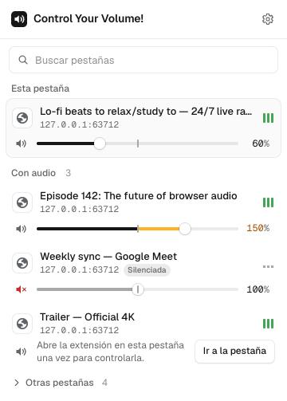
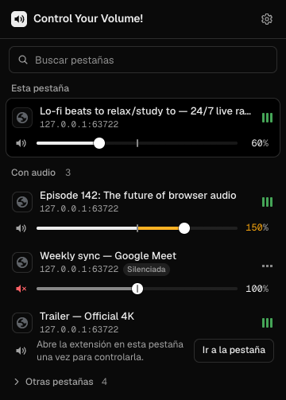

<p align="center">
  
</p>

<h1 align="center">Control Your Volume!</h1>

<p align="center">
  Per-tab volume control for Chromium browsers (Chrome, Edge, Brave, Opera, Arc, Vivaldi) on macOS and Windows,
  with an optional booster up to 200%.
</p>

<p align="center">
  
  
</p>

## Features

- **Volume per tab** from 0% to 100%, independent of every other tab.
- **Optional booster up to 200%**. Turn it on in Settings. Above 100% the slider turns amber and a limiter keeps loud passages from clipping.
- **Know which tab is which**: favicon, title, site, window number, pinned/muted/incognito tags and a live "playing" indicator.
- **The tab you're on** is always pinned at the top. Tabs playing audio come next, then everything else. Search appears when you have many tabs.
- **Keyboard first**: arrows step 1%, <kbd>Shift</kbd> + arrows step 10%, type an exact value, double-click the slider to reset to 100%.
- **Global shortcuts**: <kbd>Alt</kbd>+<kbd>Shift</kbd>+<kbd>↑</kbd>/<kbd>↓</kbd> raise or lower the current tab, <kbd>Alt</kbd>+<kbd>Shift</kbd>+<kbd>M</kbd> mutes it, <kbd>Alt</kbd>+<kbd>Shift</kbd>+<kbd>V</kbd> opens the popup (⌥⇧ on macOS). You can change them in `chrome://extensions/shortcuts`.
- **Badge** on the toolbar icon with the current tab's volume when it isn't 100%.
- **English and Spanish**, light/dark/system themes. Built on Vercel's [Geist](https://vercel.com/geist) design language.
- **Free control (optional)**: adjust tabs you never opened the extension on. Turn on **Control tabs without visiting them** in Settings.
- **Private**: no network requests and no analytics. Site access is only requested if you turn on free control. See [PRIVACY.md](PRIVACY.md).

## Install

Download the latest `.zip` from [Releases](https://github.com/iKennMarcucci/control-your-volume/releases), unzip it, open `chrome://extensions` (or `edge://extensions`, `brave://extensions`…), turn on **Developer mode**, click **Load unpacked** and pick the unzipped folder.

## How it works and its limits

The extension uses two engines and picks one per tab:

1. **Capture.** On tabs where you opened the extension (or used one of its shortcuts), it captures the tab's audio with `chrome.tabCapture` and plays it back through a Web Audio `GainNode` in an offscreen document. This controls **all** audio in a tab: videos, games, players inside iframes and Web Audio apps.
2. **Media elements (free control).** Chromium only allows capture after you open the extension on a tab. If you turn on **Control tabs without visiting them**, other tabs are adjusted through their `<video>` and `<audio>` elements instead. A small script is injected only into a tab whose volume you change. Volumes above 100% use Web Audio when the site's media allows it.

Browser rules you should know about:

- **Captured tabs show as "shared"** while their volume isn't 100%. Set it back to 100% and the capture stops after about a second. Free control doesn't show this indicator.
- **Without free control, each tab needs one visit.** Tabs you haven't opened the extension on offer an **Allow** button for free control. You can also click the tab's title to go there.
- **Free control only reaches `<video>` and `<audio>`.** Sound made with Web Audio (games, some web apps) and players inside other-site iframes may not change. Media served from another site without CORS can't go above 100%. The row tells you when this happens; opening the extension on that tab switches it to capture.
- **Fullscreen video** stays inside the browser window while the tab is being captured.
- **Browser pages** (`chrome://…`, the extension stores) can't be captured. You can still mute them.
- **Mute** uses the browser's own tab mute, so it works on every tab.

## Development

Requires Node 22+ and pnpm.

```bash
pnpm install
pnpm dev          # rebuilds dist/ on change; load dist/ as an unpacked extension
pnpm build        # production build in dist/
pnpm check        # Biome lint + format check
pnpm typecheck    # TypeScript 7 (native Go compiler)
pnpm test         # unit tests with node --test
pnpm test:e2e     # Playwright: loads the extension in Chromium and measures real audio
SCREENSHOTS=1 pnpm exec playwright test screenshots   # popup screenshots in artifacts/
```

The runtime has **no dependencies**: the popup is plain TypeScript and DOM, bundled by esbuild. Build tools are native (esbuild, TypeScript 7, Biome) so a full check runs in seconds.

```
src/
  background.ts     service worker: state, capture orchestration, badge, shortcuts
  offscreen.ts      Web Audio graph per tab (gain + limiter above 100%)
  popup.{html,ts,css}
  lib/              pure helpers (volume math, tab grouping, storage, messages)
  styles/geist.css  Geist tokens (light/dark)
  _locales/         en, es (generated by scripts/locales.mjs)
```

Biome's "heading/label/anchor has no content" checks are off for `popup.html` because that text is filled in at runtime from `_locales`.

## Releases

Versions follow semver with pre-releases: `1.0.0-alpha.N` → `1.0.0-beta.N` → `1.0.0-rc.N` → `1.0.0`. Chromium only accepts numeric versions, so the build writes the semver to `version_name` and a sortable number to `version` (`1.0.0-beta.2` → `0.9.2.2`).

```bash
node scripts/version.mjs 1.0.0-beta.1   # bumps package.json
# update CHANGELOG.md, then:
git commit -am "chore: release v1.0.0-beta.1"
git tag v1.0.0-beta.1 && git push --follow-tags
```

Pushing a `v*` tag runs the release workflow: checks, build, zip and a GitHub Release (marked pre-release when the version has `-alpha`, `-beta` or `-rc`).

## Español

**Control Your Volume!** te deja subir o bajar el volumen de cada pestaña por separado, con un amplificador opcional de hasta 200%. Está en español e inglés y sigue el idioma de tu navegador. Si activas **Controlar pestañas sin visitarlas** en Configuración, puedes ajustar cualquier pestaña sin abrir la extensión en ella (el navegador te pedirá acceso a los sitios; no se lee ni se envía nada). Para instalarla, descarga el `.zip` de [Releases](https://github.com/iKennMarcucci/control-your-volume/releases), descomprímelo y cárgalo con **Cargar descomprimida** en `chrome://extensions` con el **Modo de desarrollador** activado.

## License

[MIT](LICENSE). Geist fonts © Vercel, [SIL Open Font License](src/fonts/OFL.txt).
